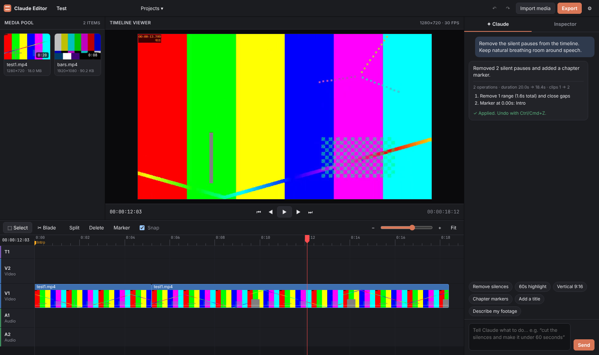

# Claude Editor

A non-linear video editor (think a lightweight DaVinci Resolve) with Claude built in as an editing assistant. It's tuned for fun, effects-heavy edits such as trading-card pack openings: Claude finds the big pulls and adds the flash, zoom, sound effects and slow-mo. Source files of any size work, including 500 MB, 5 GB or 50 GB, because **the video itself is never sent to Claude**.



## How it handles huge files

```
Your 20 GB file ──► FFmpeg (on your machine)
                     ├─ proxy.mp4        540p copy for smooth scrubbing
                     ├─ thumbnails        filmstrip for the timeline
                     ├─ waveform          audio peaks
                     ├─ scene cuts        where shots change
                     ├─ silences          pauses in the audio
                     ├─ keyframes         1 JPEG per 2 s on short videos (up to 150/file)
                     ├─ loud moments      reactions / hype points in the audio
                     └─ transcript        optional, with Whisper
                                   │
                                   ▼  (a few hundred KB)
                                Claude ──► edit plan (JSON list of operations)
                                                 │  you review & click Apply
                                                 ▼
Export ◄── FFmpeg renders the timeline from the ORIGINAL full-quality files
```

- **Import by path**: nothing is copied, so a huge file imports instantly. Uploading also works and streams to disk.
- **Editing and playback** use the proxy, so scrubbing stays smooth however big the original is.
- **Export** cuts each clip straight from the original with a fast seek, normalizes it, then joins the segments losslessly. Memory stays flat with hundreds of cuts.

### Tested sizes (4-core Linux machine)

| Source | Import | Prep (proxy and analysis) | Sent to Claude |
|---|---|---|---|
| 3 min pack opening, 720p | 0.09 s | 58 s | 90 frames + analysis (~2.5 MB) |
| 2 min, 1080p, 569 MB | 0.09 s | 33 s | ~1 KB text + 24 frames (~320 KB) |
| 20 min, 1080p, 1.2 GB | 0.09 s | 4 min 52 s | ~2 KB text + 140 frames (~1.9 MB) |

Exports come out at exactly the timeline length. A 20-minute timeline with 60 cuts and a title exported in 9 min 6 s at standard quality, at exactly 1121.900 s. A timeline with titles and extra audio tracks only re-encodes each clip once. Picture-in-picture overlays (V2) add one extra full-length pass. Machines with more cores are proportionally faster.

The design targets videos up to an hour or so. Longer ones work, but import takes longer and Claude's visual samples get sparser.

## Features

**Editor**
- Media pool with thumbnails, progress, and drag-and-drop
- Viewer with transport controls and timecode, playing every track in sync
- Multi-track timeline: titles (T1), two video tracks (V1, V2 as overlay), two audio tracks (A1, A2)
- Filmstrips and waveforms on clips
- Move, trim, blade/split, delete and ripple delete, with snapping, markers, and zoom
- Undo/redo and autosave
- Inspector: clip timing, source in/out, volume, fit or fill framing, title text and style, project format and frame rate (16:9, 9:16, 4:5, 1:1, 4K…)
- Export: H.264/AAC MP4 at draft, standard or high quality, with progress and cancel

**Effects** (✨ Effects and 🔊 Sounds menus, or ask Claude)
- Zoom punch-in, camera shake, white flash, rainbow holo shimmer, blur, black & white, spotlight vignette. They sit on two effects tracks (FX1/FX2), with adjustable intensity.
- Slow motion (any speed from 0.25× to 4×, pitch-corrected audio) and freeze frames. Later material shifts automatically to stay in sync.
- "Impact" titles: big, bold, outlined, for hype moments.
- 8 built-in sound effects, synthesized with FFmpeg so there's nothing to license: whoosh, sparkle chime, pop, bass boom, ka-ching, drumroll, tension riser, air horn.
- Everything previews live in the viewer and renders identically in the export.

**Claude assistant**
- Ask in plain English: "hype my pulls", "which moments are my best pulls?", "cut the dead air", "make a 60-second vertical Short", "add chapter markers", "what's in this footage?"
- For pack openings, Claude uses loud moments (your reactions), keyframes (one every 2 s on short videos, sharp enough to see the card) and scene changes. It times a build-up sound, then a flash, sparkle, zoom and freeze or slow-mo to each reveal. It won't guess card names it can't read.
- Claude gets the timeline, scene cuts, silences, loud moments, transcript (if available) and keyframe images. It replies with a plan built from 18 typed operations:
  - cutting: `ripple_delete_ranges`, `lift_range`, `split`, `delete_clip`, `clear_timeline`
  - placing: `insert_media`, `move_clip`, `trim_clip`
  - fun: `add_effect`, `add_sound`, `slow_motion`, `freeze_frame`, `set_clip_speed`, `add_text`
  - other: `set_clip_volume`, `set_clip_fit`, `set_format`, `add_marker`
- The footage block (analysis and keyframes) is sent first and prompt-cached, so follow-up requests on the same video cost much less.
- Every plan is dry-run first. If an operation fails, Claude gets one chance to correct it. You see the plan with its before/after duration and click **Apply**. Undo works as usual.

## Download and run (the easy way)

1. **Download:** open the repository on GitHub, switch to the `claude/gallant-cori-wg5ia2` branch, then click **Code → Download ZIP**. Unzip it somewhere, like your Documents folder.
2. **Install the two tools it needs** (one time only):
   - **Node.js:** from [nodejs.org](https://nodejs.org), click the LTS button and run the installer.
   - **FFmpeg:**
     - Windows, in PowerShell: `winget install Gyan.FFmpeg`
     - Mac, after installing [Homebrew](https://brew.sh): `brew install ffmpeg`
3. **Start it:** double-click **`Start Claude Editor (Windows).bat`** or **`Start Claude Editor (Mac).command`**. The first start installs a few packages (about a minute). Your browser then opens to the editor. Keep the black window open while you edit.
   - On a Mac, if it says the file can't be opened, right-click it, choose **Open**, then **Open** again.
4. **Add your Claude API key:** click ⚙ in the top right. Get a key at [console.anthropic.com](https://console.anthropic.com). Usage there is billed separately from a Claude.ai subscription.

## Requirements

- **Node.js 20+**
- **FFmpeg** with ffprobe on your PATH (`brew install ffmpeg`, `winget install ffmpeg`, `apt install ffmpeg`)
- An **Anthropic API key** for the assistant (console.anthropic.com). The editor works without one.
- Optional: **Whisper**, for transcripts, which let Claude edit by what's said: `pip install -U openai-whisper`

## Run it

```bash
npm install
npm start
# open http://localhost:5317
```

Add your API key under ⚙ Settings, or set `ANTHROPIC_API_KEY` before starting.

## Keyboard shortcuts

| Key | Action |
|---|---|
| Space / K / L | Play-pause / pause / play |
| ← → (Shift for 1 s) | Step one frame |
| Home / End | Go to start / end |
| S or Ctrl/Cmd+B | Split at playhead |
| B / V | Blade tool / selection tool |
| Delete / Shift+Delete | Delete / ripple delete |
| M | Add marker (Alt+click a marker to remove it) |
| N | Toggle snapping |
| + / − / Shift+Z | Zoom in / out / fit |
| Ctrl/Cmd+Z, Shift+Z | Undo, redo |
| Ctrl/Cmd+I / E / S | Import / export / save |
| Ctrl/Cmd+wheel | Zoom the timeline |

## Configuration

| Variable | Default | |
|---|---|---|
| `PORT` | `5317` | |
| `CLAUDE_EDITOR_DATA` | `./data` | Projects, proxies, exports, settings |
| `ANTHROPIC_API_KEY` | | Or set it in Settings |
| `FFMPEG_PATH`, `FFPROBE_PATH` | `ffmpeg`, `ffprobe` | |
| `PROXY_HEIGHT` | `540` | Proxy resolution |
| `MAX_JOBS` | `2` | Concurrent background jobs |
| `WHISPER_CMD`, `WHISPER_MODEL` | `whisper`, `base` | |
| `CLAUDE_EDITOR_FONT` | auto | `.ttf` used for titles in exports |

The server only listens on `127.0.0.1`, since it can read files on your machine.

## Project layout

```
shared/timeline.js   Timeline model and every edit operation (pure functions,
                     used by both the UI and the server)
server/index.js      HTTP API (Express)
server/media.js      Import pipeline: probe, proxy, thumbnails, waveform,
                     scene/silence detection, keyframes, Whisper
server/render.js     Export engine
server/ai.js         Claude integration: context building, structured edit plans
server/jobs.js       Background job queue
public/              The editor UI (plain ES modules, no build step)
test/                Unit tests for the timeline engine (npm test)
```

## Roadmap ideas

- Package as a desktop app (Electron or Tauri) with a native file picker
- Animated stickers / emoji pop-ups and particle effects (sparkles around a card)
- Transitions (crossfades, dips to black) and audio fades
- Speed changes, color correction and LUTs via FFmpeg filters
- Word-level transcript editing (delete words to cut video)
- More tracks, track mute/lock, linked A/V clips
- Hardware-accelerated encoding (NVENC, VideoToolbox, QSV)
